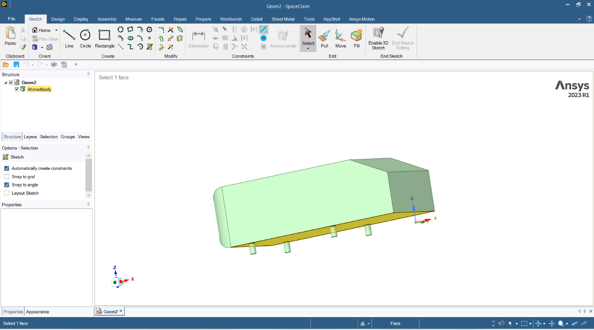
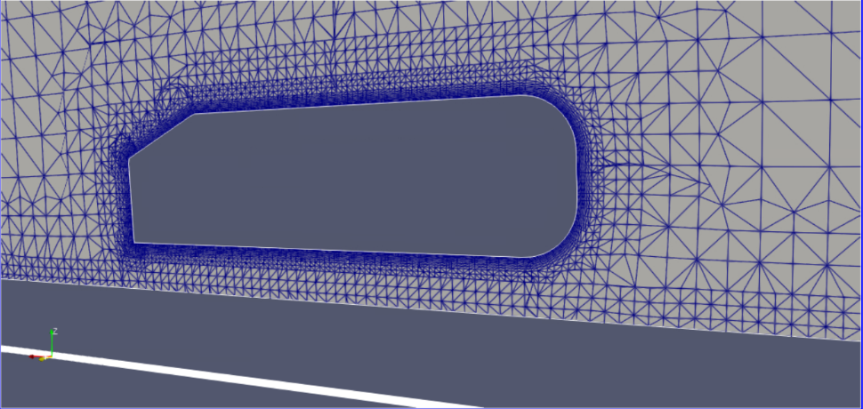

# Aerodynamische Simulation eines Ahmed-Körpers (OpenFOAM)

Validierung von RANS- und LES-Turbulenzmodellen in OpenFOAM anhand eines anerkannten Benchmarks der Fahrzeugaerodynamik.

**Kontext:** Praxisprojekt bei DHCAE Tools GmbH, Krefeld, Sommersemester 2024 (Maschinenbau M.Eng., Jade Hochschule)
**Software:** OpenFOAM (simpleFoam, pimpleFoam), Ansys SpaceClaim, CastNET, SnappyHexMesh, ParaView

> **Vertraulichkeit:** Der zugrundeliegende Praxisbericht enthält vertrauliche, unternehmensinterne Inhalte. Dieses Repository zeigt daher ausschließlich Methodik, eingesetzte Standard-Software und Ergebnisse im Vergleich zu öffentlich verfügbaren Referenzdaten, keine internen Arbeitsabläufe oder firmenspezifischen Inhalte.

## Ziel

Der Ahmed-Körper ist ein vereinfachtes, aerodynamisch anspruchsvolles Fahrzeugmodell. Widerstands- und Auftriebsbeiwert (Cd, Cl) wurden mit vier Turbulenzansätzen berechnet und gegen veröffentlichte Referenzwerte validiert.

## Geometrie und Netz

Standardmaße nach Ahmed et al. (1984), Heckschräge 25°, Länge 1,044 m. Zwei Volumenvernetzungen wurden verglichen. Für LES wurde zusätzlich ein feineres Netz mit SnappyHexMesh erzeugt.

| Netz | Zellen | Volumennetz | Grenzschicht |
|---|---|---|---|
| A | 3.623.777 | Tetraeder | 10 Schichten |
| B | 1.748.899 | Hex-Core | 10 Schichten |

## Methodik

- RANS stationär mit simpleFoam: k-ε Realizable, k-ω SST
- LES transient: Subgrid-Modelle Spalart-Allmaras und k-ω
- Luft, ν = 1,5·10⁻⁵ m²/s, Einströmung 40 m/s, Re ≈ 2.784.000 (bezogen auf die Körperlänge)
- LES-Netzqualität: Anteil der aufgelösten turbulenten kinetischen Energie geprüft (Richtwert mindestens 80 %). In ParaView wurde das Kriterium erfüllt.

## Ergebnisse

Alle vier Modelle lieferten plausible Vorhersagen. Die LES-Läufe zeigten tendenziell die geringste Abweichung.

| Modell | Cd | Abw. | Cl | Abw. |
|---|---|---|---|---|
| Referenz (Ahmed et al. / SimFlow) | 0,299 | – | 0,345 | – |
| k-ε (Realizable) | 0,264 | 11 % | 0,352 | 2 % |
| k-ω (SST) | 0,274 | 8 % | 0,335 | 2 % |
| LES (Spalart-Allmaras) | 0,282 | 5 % | 0,365 | 5 % |
| LES (k-ω) | 0,287 | 4 % | 0,356 | 3 % |

## Erkenntnisse

- Netzfeinheit und Zeitschrittwahl sind für die Aussagekraft einer LES entscheidend.
- Der Abgleich von Netzqualität, Zeitschritt und Rechenaufwand bei gleichzeitiger Einhaltung des Kriteriums für aufgelöste turbulente Energie war der zentrale Lernpunkt.

Portfolio mit Abbildungen: <https://pouria-kamali.de/projekt-ahmedbody.php>

## Abbildungen

### Geometrie

Ahmed-Körper in Ansys SpaceClaim (Maße nach Ahmed et al., 1984).

### Volumennetz

Schnitt durch das Volumennetz um den Körper mit verfeinerter Grenzschicht (ParaView).

## Repository-Inhalt

Dieses Repository dokumentiert Methodik und Ergebnisse. Case-Dateien, Rechendaten, der Praxisbericht sowie unternehmensinterne Arbeitsabläufe und Software-Einstellungen sind nicht enthalten.
